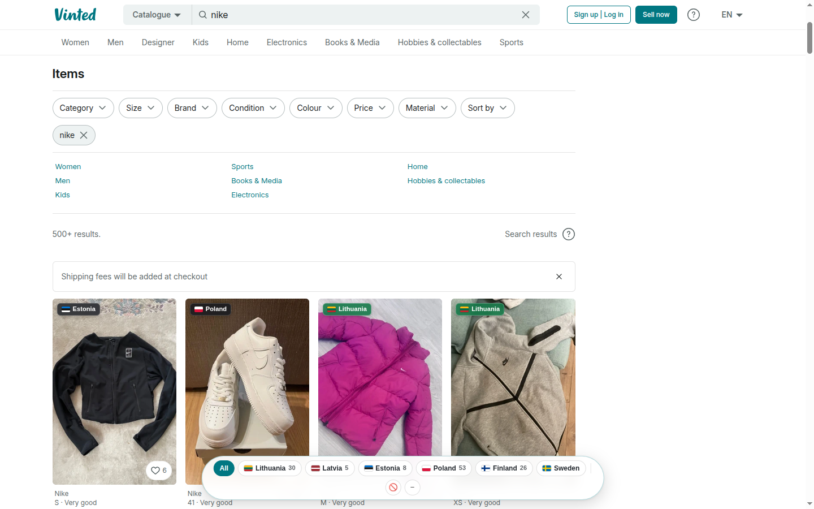
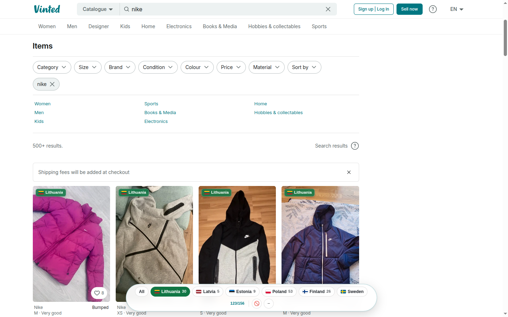

# Vinted Country Badge & Filter

A lightweight, zero-dependency Tampermonkey / Violentmonkey userscript for **all Vinted domains** that displays each seller's country right on item cards and provides a compact client-side country filter bar.

## Screenshots

**Country badges on item cards (with sellers from your current Vinted domain highlighted in green):**

**One-click country filter (`Lithuania` selected — non-matching items hidden with clean grid reflow):**

## Features

- **Universal Vinted support** — Works across `.lt`, `.pl`, `.fr`, `.de`, `.nl`, `.be`, `.es`, `.it`, `.pt`, `.at`, `.lu`, `.se`, `.dk`, `.fi`, `.cz`, `.sk`, `.hu`, `.ro`, `.bg`, `.hr`, `.si`, `.gr`, `.ie`, `.co.uk`, `.com`, and `.com.au`. Automatically highlights sellers from your current domain's country in green and picks regional filter defaults.
- **Country badges with crisp inline SVG flags** — Renders consistently on Windows, Linux, and macOS without loading external images.
- **Multi-country toggle filter bar** — Compact floating bar at the bottom of catalog/feed pages:
  - **Click** any country chip to toggle it on/off — easily pick one country or any combination of countries (`LT + LV + EE`), or click **All** to reset.
  - **Hide (`🚫`) or Dim (`👁️`) mode** — Hide mode removes non-matching grid cells cleanly so matching items reflow with zero gaps.
  - **Collapsible to bottom-right (`−`)** — Minimizes to a compact corner pill showing selected countries, live scan progress, and API request count; preferences persist per domain across pages and reloads.
- **Full item titles on cards (enabled by default)** — Reveals the complete, untruncated item title directly on every card (e.g., `Zotac Gaming GeForce RTX 3070 Ti Trinity 8GB GDDR6X RGB`) with **0 extra network requests**, toggleable via the `⚙️` settings popover.
- **No Cloudflare 403 captcha popups & no login required** — Uses `/api/v2/users/{userId}` with `Accept: application/json` instead of the heavily challenge-gated `/api/v2/items/{itemId}/details` endpoint.
- **Works with any Vinted language** — Reads canonical ISO-2 country codes (`country_iso_code`) and formats names via `Intl.DisplayNames` (no need to switch Vinted to English).
- **Seller-level LRU caching** — Caches by `userId` (not `itemId`) for 14 days in a single bounded `localStorage` key (up to 5,000 sellers). Seeing a seller once resolves all their other listings instantly with zero extra requests.
- **Gentle, rate-limit-friendly pacing** — Viewport-first lazy loading via `IntersectionObserver`, single-stream sequential requests (`800–1200 ms` with random jitter), automatic pause when the browser tab is hidden, and automatic `429` / `Retry-After` backoff.

## How It Works

1. Every rendered Vinted item card already contains the seller's `user.id` inside its React Fiber props (`__reactFiber$...`). The script extracts this ID locally with **0 network requests**.
2. It checks the local seller cache (`vlt_seller_country_cache_v1`). Cached sellers are labeled immediately.
3. For uncached visible cards (or remaining page cards when a country filter is active), it fetches `/api/v2/users/{userId}` with `Accept: application/json`, caches the seller's `country_iso_code` and `city`, and updates all cards belonging to that seller at once.

> **Note on server-side filtering:** Vinted ignores `country_ids[]` query parameters and does not include seller country in catalog search payloads or expose a batch user lookup endpoint. Fetching once per unique seller and caching by seller ID minimizes total requests.

## Installation

1. Install a userscript manager in your browser:
   - [Tampermonkey](https://www.tampermonkey.net/) (Chrome, Firefox, Edge, Safari)
   - [Violentmonkey](https://violentmonkey.github.io/) (Chrome, Firefox, Edge)
2. **[Install directly from Greasy Fork](https://greasyfork.org/uk/scripts/606593-vinted-country-badge-filter)** — or create a new userscript and paste the contents of [`vinted-country-filter.user.js`](./vinted-country-filter.user.js).
3. Visit any supported Vinted site and browse normally.

## Configuration

All options live in the `CONFIG` object at the top of [`vinted-country-filter.user.js`](./vinted-country-filter.user.js):

| Option | Default | Description |
|---|---|---|
| `DISPLAY_LOCALE` | `'en'` | Language for UI & country names: `'en'`, `'lt'`, `'uk'`, or `'auto'` (follows Vinted's page language) |
| `SHOW_FULL_TITLE` | `true` | Show full untruncated item title on cards (can also be toggled in the `⚙️` settings popover) |
| `SHOW_CITY` | `false` | Show seller city alongside country on item badges (e.g., `Lithuania · Vilnius`, also toggleable in `⚙️`) |
| `SHORT_CODE` | `false` | Show 2-letter ISO code (`LT`, `PL`, `FI`) instead of full country name on badges |
| `HIGHLIGHT_LOCAL` | `true` | Highlight sellers from the current domain's country in green |
| `SHOW_FILTER_BAR` | `true` | Show the floating bottom country filter bar (`false` for badges-only mode) |
| `DEFAULT_FILTER_COUNTRIES` | `'auto'` | `'auto'` picks regional countries for the current domain, or pass an explicit array like `['LT', 'LV', 'EE']` |
| `CONCURRENCY` | `1` | Parallel API requests (keep `1` for gentlest pacing) |
| `REQUEST_DELAY_MS` | `800` | Base delay between requests in milliseconds |
| `REQUEST_JITTER_MS` | `400` | Random extra delay (`0..N` ms) added between requests |
| `CACHE_TTL_DAYS` | `14` | Days to retain cached seller locations |
| `CACHE_MAX_USERS` | `5000` | Maximum sellers stored in the `localStorage` LRU cache |

## Privacy & Disclaimer

- **100% client-side & read-only:** No data is sent to any third-party server, no tracking, no analytics, and no automated actions (no buying, messaging, or favoriting).
- **Unofficial tool:** This project is not affiliated with or endorsed by Vinted. Use responsibly and avoid excessive rapid pagination while filtering.

## License

MIT
